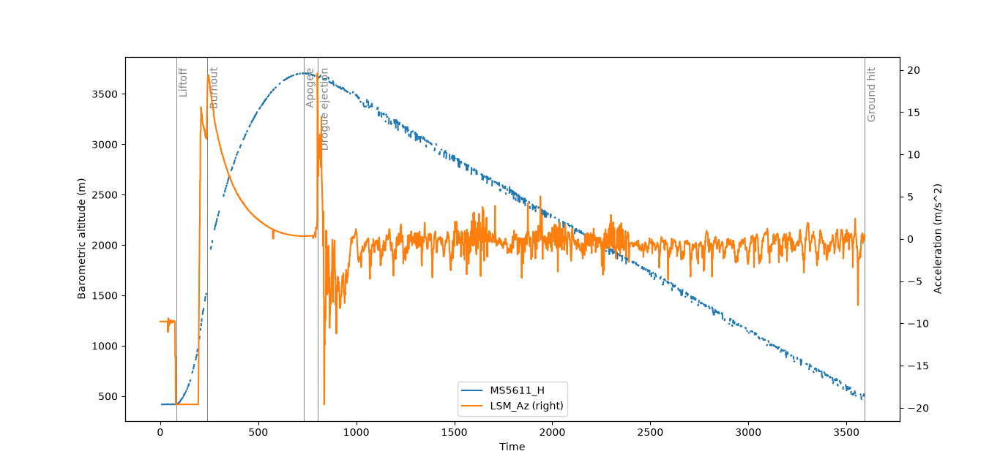

# Analysis of flight data using Python

## Identificación de los eventos del vuelo

## Anomalías o comportamientos inesperados

- El barómetro BMP581 solo arroja datos inválidos sobre la presión y no muestra la altitud.
- El acelerómetro H3LIS200 muestra datos muy imprecisos.
- A partir de la gráfica de la aceleración solo se puede observar el despliegue del drogue; no parece que se haya desplegado el main.
- No consigo determinar a qué se debe la aceleración negativa de -19,59 m/s2 en el momento del despegue.

## Algoritmos que implementaría en el software de vuelo

- Un filtro de Kalman para saber determinar con precisión el estado real del cohete (altitud, aceleración y orientación), lo que también resultaría útil para saber elegir entre leer el acelerómetro Low-G o el High-G (aunque no parece que fuera necesario en este caso).
- Un proceso que esté activamente pendiente del estado del paracaídas y que pueda activarlo en un caso extremo cuando no funcione bien el barómetro (por ejemplo, teniendo en cuenta el tiempo estimado de cada fase de vuelo calculado previamente en simulaciones).
